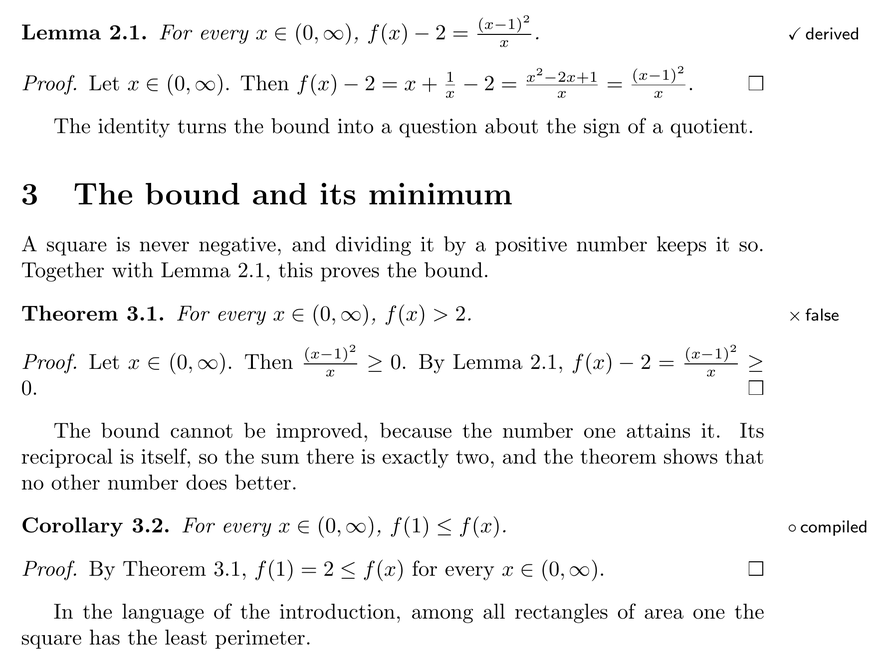

# Quick start: your article in five minutes

You need an article in LaTeX. You do not need to know Lean for the first two steps.

## 1. Add one line and compile

Put the checker `leanify` on your `PATH` (the
[releases](https://github.com/Corrram/leanify/releases) have it for Linux, macOS and
Windows; it needs neither Lean nor mathlib), and load the package:

```latex
\usepackage{leanify}
```

`leanify.sty` is on CTAN; you can also copy
[`tex/leanify.sty`](https://github.com/Corrram/leanify/blob/main/tex/leanify.sty) next to
the article. Compile with shell escape (`pdflatex -shell-escape`, or the setting of your
editor). The PDF is the same as before. The log has something new: what Leanify could not
read, at the lines of your article.

```
Package leanify Warning: g is not defined: sentence not checked on input line
(leanify)                70.
Package leanify Warning: Corollary cor:min is not checked: Leanify cannot read
(leanify)                its statement; docs/writing.md lists the forms it
(leanify)                reads on input line 77.
```

These are the findings for the draft of the [tutorial](getting-started.md): a typo in a
proof (`g` for `f`), and a corollary whose wording has no fixed reading. Nothing is
guessed. A sentence either has one reading, or it is reported.

Without shell escape nothing runs, and the package says so. The command line gives the
same findings: `leanify check article.tex`.

## 2. Remove the ambiguities

Fix what the warnings name. Most fixes are small and make the article clearer for human
readers too:

| The draft says | Leanify asks | The article then says |
| --- | --- | --- |
| `$g(x)-2=\frac{(x-1)^2}{x}$` | what is `g`? | `$f(x)-2=\frac{(x-1)^2}{x}$` |
| `$f$ attains its minimum on $(0,\infty)$ at $1$.` | which statement is this? | `For every $x\in(0,\infty)$, $f(1)\le f(x)$.` |
| `Define $f:\mathbb{R}\to\mathbb{R}$ by $f(x)\coloneqq x+\frac1x$.` | what is `f(0)`? | `Define $f:(0,\infty)\to\mathbb{R}$ by …` |

Then look at what your theorems say, in the notation of the article:

```
leanify check article.tex --claims
article.tex:64:1: info: claim 2: \forall x\in \mathbb{R},\ 0<x\Rightarrow 2<f(x)
```

This line is the formal statement of the theorem at line 64. It is computed from your
sentence, so it cannot drift away from the paper, and it is short enough to read.
[Writing for Leanify](writing.md) lists the wordings that are read. If your subject has
words of its own (a copula, a graph, a prime), load its
[vocabulary](vocabularies.md): `\usepackage[vocab=unitsquare]{leanify}`.

## 3. Have the statements proved

```sh
leanify certify article.tex
```

makes a Lean project for the article (the folder `lean` next to it), writes one proof
obligation for every definition and claim, and builds the certificate. For this step you
need Lean ([elan](https://github.com/leanprover/elan) installs it). The obligations can
be proved by you, or by a model: `scripts/leanify_prove.py --hook CMD` gives every open
obligation to a command of yours and keeps a proof only if Lean accepts it.

A proof that is missing leaves its claim *unverified*, and a claim that is false as
stated can be *refuted*. The draft's theorem says `$f(x)>2$`, which fails at `x = 1`.
With `\usepackage[status]{leanify}` the margin of the PDF then says so, next to the
theorem:



## Where to go next

* [The tutorial](getting-started.md) takes the same note through every step, with the
  real output of each.
* [The live demo](demo.md) shows the web reader of a certified article: every sentence
  with its status, its formal reading and its Lean statement.
* [What a certificate guarantees](getting-started.md#what-a-certificate-guarantees), and
  [what it does not say](reference.md#what-a-verified-claim-does-not-say).
